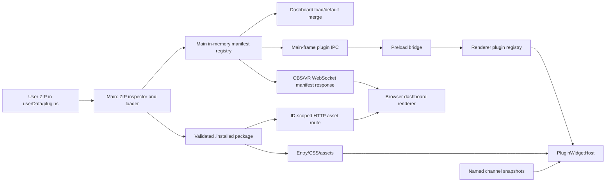

# Widget plugins: architecture and delivery plan

## Purpose and authority

This document maps the widget plugin v1 contract to the current `widget-plugins`
branch. [`PLUGIN_API_V1.md`](./PLUGIN_API_V1.md) defines the external package
contract; [`ARCHITECTURE_RULES.md`](./ARCHITECTURE_RULES.md) remains authoritative
for implementation decisions. The local phase 2–3 completion summary records
implementation intent, but source files and runtime evidence determine status.

The host owns windows, placement, dashboard persistence, visibility, settings,
channel subscriptions and delivery. A plugin supplies one React widget's content.
Users put a ZIP in the per-user `plugins/` directory and restart the app to
discover or replace it. The app does not download, execute main-process modules
from, or run install scripts from a package.

The author-facing workflow is documented in
[`PLUGIN_WIDGET_DEVELOPMENT.md`](./PLUGIN_WIDGET_DEVELOPMENT.md); keep it in
sync with the contract and the host's public channel allowlist.

## Boundaries and data flow

| Boundary                  | Owner and files                                                                                 | Contract                                                                        |
| ------------------------- | ----------------------------------------------------------------------------------------------- | ------------------------------------------------------------------------------- |
| Author package            | `plugin.json`, `dist/index.js`, optional CSS/assets                                             | One widget per ZIP; versioned manifest and UMD/IIFE entry                       |
| Main package admission    | `src/app/plugins/zipArchive.ts`, `pluginLoader.ts`                                              | Inspect and bound ZIP, validate manifest, install to cache atomically           |
| Main-to-renderer metadata | `src/app/bridge/widgetPluginBridge.ts`, `widgetPluginRendererBridge.ts`, `src/preload.ts`       | Main-frame, no arbitrary path argument; validated descriptors only              |
| Renderer registration     | `src/frontend/pluginRegistry.ts`, `WidgetIndex.tsx`, `widgetRuntime.tsx`                        | Runtime external IDs alongside compile-time built-ins                           |
| Rendering                 | `src/frontend/PluginWidgetHost.tsx`                                                             | Lazy entry/CSS load, host React runtime, declared snapshots, error boundary     |
| Settings and persistence  | `src/frontend/components/Settings/sections/PluginSettings.tsx`, `src/app/storage/dashboards.ts` | Host controls, validated config, preserved identity for missing packages        |
| Browser sources           | `src/app/webserver/bridgeProxy.ts`, `componentServer.ts`, `componentRenderer.tsx`               | Manifest over WebSocket, scoped asset route, local component server bind policy |

The built-in `WidgetId` and `WidgetConfigMap` remain compile-time closed. External
IDs use a runtime-validated path and retain their string IDs in saved dashboards.
The renderer initializes plugin descriptors before first widget lookup. It loads
the plugin entry only when a host for that plugin mounts. Hidden or disabled
widgets therefore need no plugin script execution.

## Package and API v1

The ZIP has exactly one top-level directory containing `plugin.json` and
`dist/index.js`; optional `styles` name package-local CSS files. The manifest
has `manifestVersion: 1`, a namespaced stable `id`, SemVer `version`,
`apiVersion: 1`, a widget name, initial width/height, `defaultConfig`,
declarative `settings`, and `requires.channels`. The host derives the entry
global name from the ID with `getPluginGlobalExport`. No ZIP filename or
filesystem location becomes widget identity.

`PluginWidgetProps` carries `widgetId`, read-only validated `config`, partial
declared `snapshots`, a currently empty read-only `theme`, `preview`, and
`onConfigChange`. The plugin build externalizes `react` and
`react/jsx-runtime` to `window.__IRDASHIES_PLUGIN_HOST__`, so hooks share the
host's React instance. Entry is a classic script under the existing CSP;
`eval`, `blob:` loading, main-process entry points and custom settings pages
are outside v1. Plugin CSS must be scoped to its widget root.

Only named snapshot channels admitted by `PUBLIC_PLUGIN_CHANNELS` in
`src/types/plugins.ts` may appear in `requires.channels`. The allowlist excludes
event channels and internal snapshots such as replay context and stream chat;
the ZIP loader rejects those declarations before installation. The renderer
uses channel definitions and caps rates to the channel registry. A plugin has
no raw telemetry or generic plugin IPC endpoint. The public SDK name in the API
document, `@irdashies/plugin-api`, still needs a distributable author package or
an equivalent documented consumption path before third-party authors can
install it as written.

## Trust and security model

Installing a plugin is a decision to run trusted third-party JavaScript in the
shared renderer. The manifest and channel list define the cooperative API; they
do **not** sandbox code or prevent access to renderer-global bridges. Do not
describe community ZIPs as safe simply because admission succeeds.

The ZIP inspector rejects traversal, duplicate archive paths, unsafe links,
unsupported formats/compression, overlapping records, native/executable file
extensions and packages above its byte/file limits. Current limits include
50 MiB per ZIP, 200 MiB total candidate ZIP bytes, 100 MiB expanded content,
32 MiB per file and 256 files. The loader validates IDs, versions, fixed entry,
settings, defaults and channels before installation. Installed HTTP reads
re-check the requested ID/path and restrict files to the entry, declared CSS
and `dist/assets/` within the validated installed package.

Electron's renderer CSP and secure window defaults remain in force. The browser
component server follows its existing loopback/network bind setting; enabling
network access can expose plugin manifests and served assets on that network.
`dashboard-view-entry.tsx` admits browser plugin asset origin only after its
referrer/page-origin check. That check and the shared-renderer trust model need
review together during runtime verification. Never weaken CSP or expose a
general filesystem path route to make plugin loading work.

## Installation and update lifecycle

1. At startup `src/main.ts` scans `app.getPath('userData')/plugins` before
   dashboard defaults load. It initializes the plugin bridge after the scan.
2. The loader considers bounded `.zip` candidates, validates archives and
   manifests, and rejects collisions with built-in IDs or other candidate IDs.
3. A valid candidate is extracted to a staging directory under `.installed`.
   Replacement moves the previous directory to a backup and renames the stage
   into place; a failed replacement attempts to restore the backup.
4. The in-memory registry exposes frozen manifests and generated `file:` URLs.
   If a source ZIP disappears or is invalid, a previously valid cached package
   can still be loaded. Removing the source ZIP is not an uninstall operation.
5. Renderer startup receives descriptors through preload IPC. A mounted widget
   loads script and CSS from the installed package. A subsequent ZIP change is
   visible only after an app restart in v1.

The loader treats scan/install failures as package-local where possible, logs
them through the project logger and continues with other valid packages.
Directory initialization failure yields an empty registry instead of preventing
app startup. There is no in-app uninstall, marketplace or automatic update flow.

## Renderer, settings and dashboard behavior

`pluginRegistry.ts` keeps installed descriptors and channel-rate metadata.
`WidgetIndex.tsx` resolves a built-in definition first, then an external
descriptor. `PluginWidgetHost.tsx` loads the derived global export, validates
asset URLs, displays loading/failure states, subscribes to declared snapshots
while mounted, and catches render exceptions inside `ErrorBoundary` with a
plugin-ID label. `onConfigChange` accepts a partial patch only after host
validation; the host then updates the dashboard through the normal persistence
path.

`PluginSettings.tsx` renders boolean, number, select and text controls from the
manifest and a direct shared-renderer preview. Default values come only from
`defaultConfig`. Existing saved config is normalized at load/render/update
boundaries. `dashboards.ts` merges installed plugin defaults when loading a
dashboard. If a package is missing, the saved widget type, instance ID and
config remain; UI entry points render an unavailable state instead of deleting
the widget. This is essential for reinstalling a package without losing user
layout or preferences. Any future breaking config schema requires an explicit
dashboard-load migration under architecture rule R8.2.

`src/widgetPreview.tsx` iframe preview is not plugin-capable in the current
implementation. Gantry and Dock do not host plugin widgets. Those are scope
limits, not evidence that the ordinary overlay and browser paths work in a
packaged Electron build.

## OBS/VR component server

The WebSocket `getInstalledPlugins` response contains manifests, not local
filesystem paths. The browser bridge derives ID-scoped URLs from the component
server origin. `GET /plugin-assets/:pluginId/:relativePath` serves a regular
file only through `readInstalledWidgetPluginAsset`. `/dashboard` and
`/widget/<id>` continue to use the existing browser renderer. The HTTP route
sets a MIME type, `nosniff` and `no-store`; unknown/invalid plugin assets
return 404. The server's existing bind and network-access settings determine
who can reach the route.

## Phases and acceptance criteria

The only located phase summary explicitly names phases 2 and 3. The phase 1
description below is an inferred scope from the v1 API document and must not
be treated as a historical phase record.

| Phase                                  | Scope                                                                                                            | Current status                                                                                                                                                     | Acceptance evidence                                                                                                                                                                                                                              |
| -------------------------------------- | ---------------------------------------------------------------------------------------------------------------- | ------------------------------------------------------------------------------------------------------------------------------------------------------------------ | ------------------------------------------------------------------------------------------------------------------------------------------------------------------------------------------------------------------------------------------------ |
| 1 — contract and author API (inferred) | Define package shape, manifest, props, public channels, React bundling rules and trust statement                 | Development guide and standalone `packages/plugin-api` source now exist; build and npm pack dry-run pass. A sample ZIP build and packaged-renderer run remain open | A third party can build one example ZIP from documented steps; manifest and types match what the host admits; sample runs with host React                                                                                                        |
| 2 — discovery and host admission       | ZIP inspection, bounded validation, staging/cache, main registry, preload IPC, storage defaults                  | Implemented in source, with focused spec files; packaged execution not yet evidenced here                                                                          | Valid ZIP installs; unsafe/malformed ZIP is rejected without harming other packages; failed replacement retains last valid; missing ZIP retains cache; saved widget data survives package absence                                                |
| 3 — renderer and browser integration   | Runtime registration, lazy script/CSS, snapshots, settings, unavailable state, OBS/VR manifest and asset service | Implemented in source, with focused spec files; Electron packaged-renderer proof and browser end-to-end proof remain open                                          | Widget appears in Plugins menu, renders only when used, receives declared channels at host rate cap, persists validated settings, survives missing package, isolates failures; browser `/dashboard` and `/widget/<id>` render from scoped assets |

### Remaining verification and risks

- Latest local verification on branch `widget-plugins`: `npm run lint` passed;
  9 focused plugin suites passed (78 tests). The dashboard storage spec could
  not start because this environment's Electron binary is not installed. The
  component-server test initially exposed an overly permissive widget URL
  matcher; the matcher was tightened to the documented ID syntax. The settings
  preview test had a stale mock path and was corrected. Re-run the focused
  checks after the current working-tree changes are committed.
- The author SDK build (`npm --prefix packages/plugin-api run build`) succeeds;
  `npm pack --dry-run --ignore-scripts` includes only `package.json`,
  `release/index.js` and `release/index.d.ts`. The SDK is not published. The
  host and package currently carry parallel public-channel lists, guarded by a
  spec that requires them to match.
- Exercise a real sample ZIP in a **packaged** Electron renderer: prove `file:`
  script/CSS load under CSP, the derived UMD global resolves and React hooks
  use the host instance. This is the main runtime acceptance gap.
- Exercise the browser source with the component server on loopback and, when
  configured, a network bind. Confirm manifest delivery, origin checks, URL
  resolution, 404 behavior and asset content types.
- Inspect subscribed channel rates and unsubscription on widget unmount;
  profile memory and render frequency with a representative plugin.
- Verify exact public channel admission against a distributable SDK. A typed
  import in the design document alone is not a consumable author package.
- Test install/update/restart and missing-plugin dashboard restoration with
  user-visible settings. Preserve plugin instance identity across all paths.
- Revisit authoring, CSS isolation, preview and Gantry/Dock support in separate
  work if required. v1 does not promise them beyond the stated scope.

## Explicitly outside v1

Package signing, an untrusted-code sandbox, remote catalog, automatic updates,
hot installation, uninstall UI, main-process plugin modules, custom plugin
settings pages, multiple widgets per ZIP, dependencies between plugins, raw
telemetry access and plugin-defined processors each need their own design.
